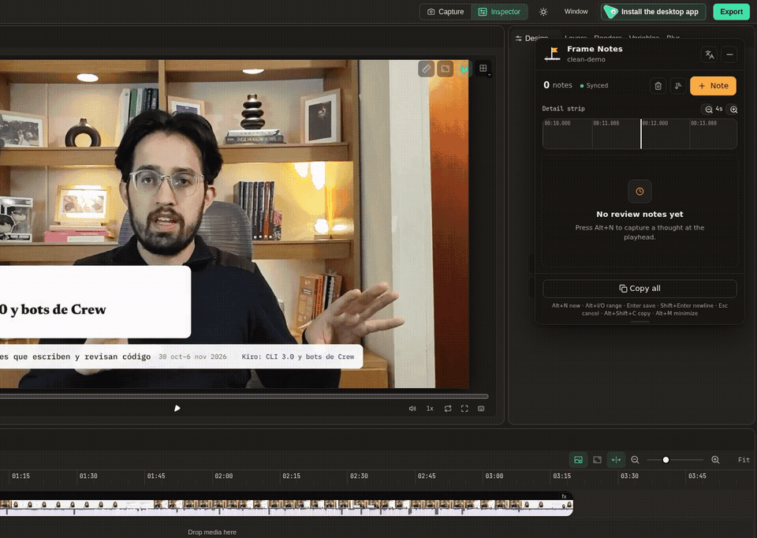
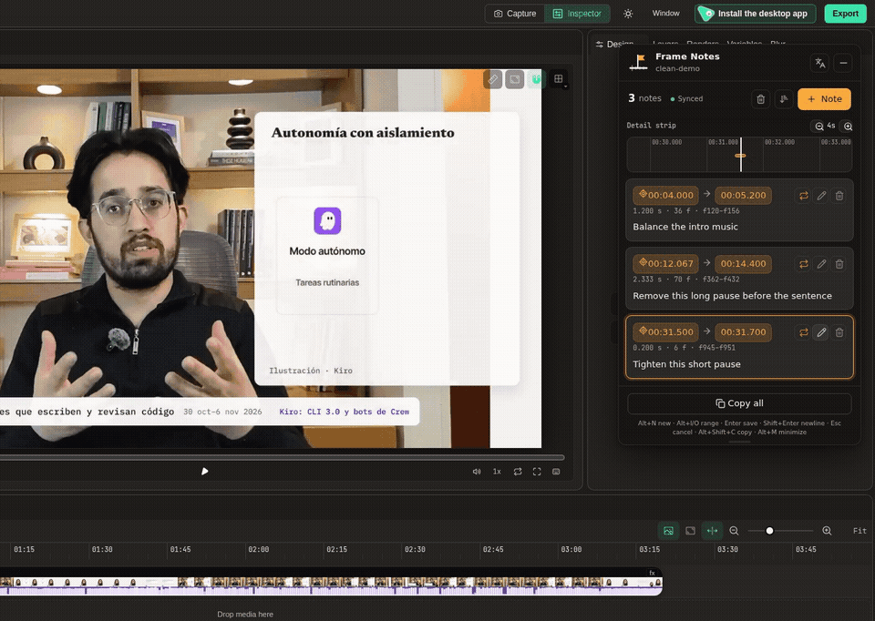
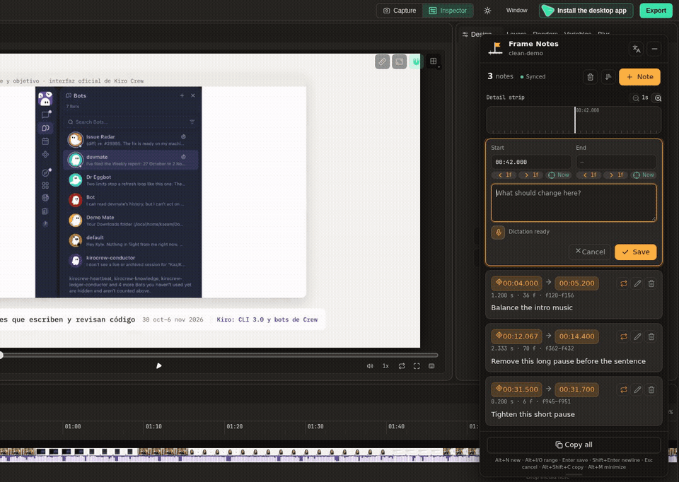
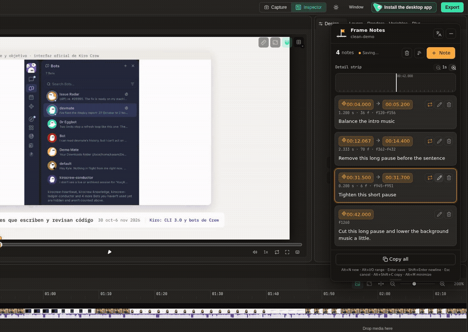

<div align="center">
  
  <h1>Frame Notes</h1>
  <p>Frame-accurate review notes for HyperFrames Studio — type or dictate, then hand them to your AI agent.</p>
  <p>
    <a href="https://chromewebstore.google.com/detail/frame-notes/alfmkhdlkkpdflhkcanfkdgfggilhemo"></a>
    <a href="https://chromewebstore.google.com/detail/frame-notes/alfmkhdlkkpdflhkcanfkdgfggilhemo"></a>
    <a href="https://github.com/BOTOOM/frame-notes/releases/latest"></a>
    <a href="LICENSE"></a>
    <a href="https://github.com/BOTOOM/frame-notes/releases/latest"></a>
  </p>
  <p>
    <a href="https://chromewebstore.google.com/detail/frame-notes/alfmkhdlkkpdflhkcanfkdgfggilhemo">Add to Chrome</a> ·
    <a href="https://github.com/BOTOOM/frame-notes/releases/latest">Firefox (Releases)</a> ·
    <a href="https://frame-notes.edwardiaz.dev/">Website</a> ·
    <a href="https://github.com/BOTOOM/frame-notes/issues/new">Report an issue</a>
  </p>
  
</div>

## What is Frame Notes?

Frame Notes is a free, open-source browser extension for Chrome and Chromium
browsers such as Edge and Brave, plus Firefox. It adds a floating panel over a
local HyperFrames Studio preview so you can mark time ranges with millisecond
timecodes and frame numbers, then type or dictate review notes. Chrome supports
on-device speech recognition and local Whisper dictation; Firefox uses Whisper.
Notes stay in the browser and are written to `review-notes.md` and
`review-notes.json` in the project for AI agents—there is no backend or account.

## Features

### Zoom into sub-second ranges

Zoom the Studio timeline and inspect short ranges in the detail strip.



### Dictate a note locally

Start Whisper dictation from the editor, review the recognized text, and save it
as a time-linked note.



### Copy notes for AI agents

Sort the note list, copy all notes, and inspect the generated Markdown file.



## Install

### Chrome, Edge, or Brave

Install Frame Notes from the
[Chrome Web Store](https://chromewebstore.google.com/detail/frame-notes/alfmkhdlkkpdflhkcanfkdgfggilhemo).
For manual installation, download the latest ZIP from
[GitHub Releases](https://github.com/BOTOOM/frame-notes/releases/latest), unzip
it, open `chrome://extensions`, enable Developer mode, choose **Load unpacked**,
and select the extracted folder. In Edge, first enable **Allow extensions from
other stores** on `edge://extensions`.

### Firefox

Download the `.xpi` from
[GitHub Releases](https://github.com/BOTOOM/frame-notes/releases/latest). Load it
as a temporary add-on from `about:debugging#/runtime/this-firefox` until the
Firefox Add-ons listing is live.

### From source

Requirements: Node.js and pnpm.

```sh
pnpm install
pnpm build
```

- **Chrome:** open `chrome://extensions`, enable Developer mode, choose **Load
  unpacked**, and select `apps/extension/.output/chrome-mv3`.
- **Firefox:** run `pnpm build:firefox`, open `about:debugging#/runtime/this-firefox`,
  choose **Load Temporary Add-on**, and select
  `apps/extension/.output/firefox-mv2/manifest.json`.

The extension runs on Studio previews at `http://localhost:<port>/#project/<id>`
and `http://127.0.0.1:<port>/#project/<id>`.

## How to use

1. Open a local project in HyperFrames Studio from a browser preview.
2. Press **Alt+N** at the playhead, then set the note's start and end with
   **Alt+I** and **Alt+O** or the range controls.
3. Type a description or dictate it, then save. Use the timeline and detail
   strip to refine short ranges one frame at a time.
4. Click **Copy all** or let your local AI agent read `review-notes.md` from the
   project root.

### Shortcuts

- **Alt+N:** pause and start a new note at the playhead.
- **Alt+I / Alt+O:** set the edited note's start / end to the playhead. Alt+I
  starts a draft when none is open; Alt+O updates the most recently edited note.
- **Enter / Shift+Enter:** save / insert a newline.
- **Escape:** cancel the draft or edit.
- **Alt+Shift+C:** copy all notes.
- **Alt+M:** minimize or expand the panel.
- **Alt+V:** start on-device dictation in the editor, creating a note at the
  playhead when needed.

The same main actions are registered as extension commands and can be remapped
from the browser's extension shortcut settings.

The popup's **Dictation engine** setting selects Auto, Chrome on-device, or
Whisper (local). Chrome language packs and the Whisper model are downloaded only
after an in-panel confirmation. Dictation audio is processed on this device.
Whisper uses the `onnx-community/whisper-base` model, with WebGPU fp16 when
available and WASM q8 otherwise.

## For AI agents

### Review-notes files

For each Studio project, notes are stored in extension-local browser storage and
mirrored to the project root as:

- `review-notes.json`: the versioned `NotesDoc` source of truth.
- `review-notes.md`: a readable, agent-oriented list of composition times and
  frame numbers.

Times are composition time in seconds. Frame numbers are rounded using the
composition's fps. While a Studio tab for the project is open, the extension
owns these files and may overwrite them during sync. Agents should read
`review-notes.md` rather than edit either file, use each time range as the review
target, and leave the files in place; deleting every note writes an empty
document rather than deleting either file.

Example generated by the extension:

```md
# Review notes — clean-demo

Produced by Frame Notes. Times are composition time; frames use 30 fps.

For agents: read these notes before editing and use each range as a review target.

Review notes — clean-demo (4 notes, 30 fps)
1) 00:04.000 → 00:05.200 (f120–f156, 1.200 s): Balance the intro music
2) 00:12.067 → 00:14.400 (f362–f432, 2.333 s): Remove this long pause before the sentence
3) 00:31.500 → 00:31.700 (f945–f951, 0.200 s): Tighten this short pause
4) 00:42.000 (f1260): Cut this long pause and lower the background music a little.
```

## Privacy

Frame Notes has no backend or account; notes stay in browser storage and the
local project files. The Whisper model is downloaded from Hugging Face only
after you choose it. Read the [English privacy policy](https://frame-notes.edwardiaz.dev/en/privacy).

## FAQ

### Does it work with long videos?

Notes use composition time and frame numbers, and the timeline can be zoomed to
review short ranges inside a long project.

### Is Frame Notes free?

Yes. Frame Notes is free and open source under the Apache-2.0 license.

### Does audio leave my computer?

Chrome's on-device recognition and local Whisper process dictation on your
device. Whisper downloads its model from Hugging Face only after you choose it.

### Does it work in Firefox?

Yes. Install the `.xpi` from GitHub Releases and load it temporarily through
`about:debugging` until the Firefox Add-ons listing is live. Firefox uses local
Whisper dictation.

### How does my AI agent read the notes?

The agent can read `review-notes.md` from the project root. The JSON file is the
versioned source of truth; agents should read the Markdown and not edit either
file while Studio is open.

### Is Frame Notes affiliated with HyperFrames or HeyGen?

No. Frame Notes is an independent project and is not affiliated with or endorsed
by HyperFrames or HeyGen.

## Support

Support development through [GitHub Sponsors](https://github.com/sponsors/BOTOOM)
or [Buy Me a Coffee](https://buymeacoffee.com/edwardiazdev).

## Development

Run `pnpm lint`, `pnpm typecheck`, `pnpm test`, `pnpm build`, and
`pnpm build:firefox`. Project notes remain local-only when Studio's file API is
unavailable.

## Releasing

See [docs/RELEASING.md](docs/RELEASING.md) for automated versioning, releases,
and extension-store submissions.

## Deploying the landing on Vercel

Create a Vercel project for this repository with **Root Directory** set to
`apps/landing`. Set `NEXT_PUBLIC_SITE_URL` to the landing's canonical HTTPS URL
and assign the chosen subdomain in the Vercel project settings. Vercel builds
the Next.js app natively; `apps/landing/vercel.json` skips builds when a change
does not touch the landing app.

The landing's privacy policy and terms are informational and are not legal
advice. Optional legal/contact values can be configured with
`NEXT_PUBLIC_LEGAL_OWNER`, `NEXT_PUBLIC_CONTACT_EMAIL`, and
`NEXT_PUBLIC_LEGAL_EFFECTIVE_DATE`; unset values remain omitted, with GitHub
Issues used as the contact channel.